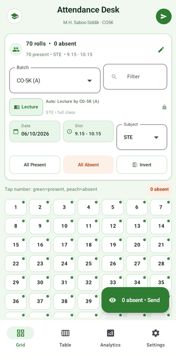
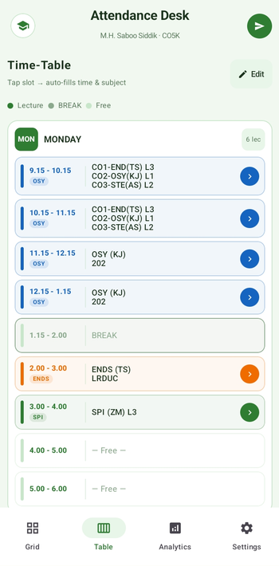
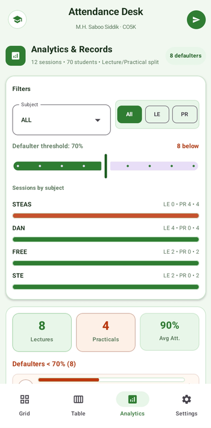
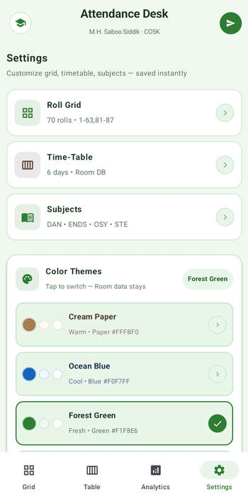

# Attendance Desk

<p align="center">
  
</p>

<h3 align="center">A modern, offline-first Android attendance management system</h3>

<p align="center">
  Timetable-aware attendance • Analytics • Defaulter Detection • Excel Reports • Backup & Restore
</p>

---

## 📱 About

**Attendance Desk** is an offline-first Android application designed to simplify student attendance management for lectures and practical sessions.

The application allows faculty/users to quickly record attendance, manage batches, view attendance history, identify students below the required attendance percentage, generate Excel reports, and back up attendance data.

The application is designed around a **local-first architecture**, meaning the core attendance data is stored locally on the device and does not require a continuously available internet connection.

---

## ✨ Features

### 📋 Attendance Management

- Record attendance for individual sessions
- Lecture and practical attendance support
- Mark students as Present/Absent
- Quick **All Present**, **All Absent**, and **Invert** actions
- Grid-based student selection
- Roll-number based student management
- View the number of present and absent students before saving

### 🕐 Timetable Integration

- Timetable-aware attendance sessions
- Automatic subject detection from timetable information
- Lecture/practical awareness
- Batch-aware attendance
- Session date and time tracking

### 👥 Batch Management

Supports batch-based attendance such as:

- CO1
- CO2
- CO3

This helps manage practicals and other batch-specific sessions more efficiently.

### 📊 Analytics

- Attendance percentage calculation
- Student-wise attendance statistics
- Attendance history
- Defaulter identification
- 75% attendance threshold
- Attendance performance overview

### 📑 Excel Reports

Attendance data can be exported into Excel reports containing attendance information for lectures and practicals.

Reports can be used for:

- Academic records
- Attendance analysis
- Faculty reporting
- Student monitoring

### 💾 Backup & Restore

Attendance data can be backed up locally and restored when required.

This helps protect attendance records against:

- Device failure
- Accidental deletion
- Application reinstallation
- Data loss

### 🎨 Themes

Attendance Desk includes multiple visual themes for a personalized experience.

Available themes include:

- Cream
- Ocean
- Forest
- Sunset
- Lavender
- Midnight

### ⚡ Offline First

The application is designed to work without requiring a server or constant internet connection.

Core attendance data is stored locally using a Room/SQLite database.

---

# 📸 Screenshots

## Attendance Marking

<p align="center">
  
</p>

## Timetable / Attendance Management

<p align="center">
  
</p>

## Analytics

<p align="center">
  
</p>

## Settings / Other Features

<p align="center">
  
</p>

> Replace the screenshot filenames above with your actual image filenames.

---

# 🏗️ Technology Stack

| Technology | Purpose |
|---|---|
| Android | Application platform |
| Java / Kotlin | Application development |
| Jetpack Compose | User interface |
| Material 3 | UI components and theming |
| Room | Local database |
| SQLite | Local data storage |
| Apache POI | Excel report generation |
| FileProvider | Secure file sharing |
| MediaStore | File/backup handling |
| Gradle | Build system |

---

# 🧠 Architecture

Attendance Desk follows an **offline-first architecture**.

The local database acts as the primary source of truth for attendance information.

```text
                ┌─────────────────────┐
                │    Android UI       │
                │   Jetpack Compose   │
                └──────────┬──────────┘
                           │
                           ▼
                ┌─────────────────────┐
                │ Application Logic   │
                │ Attendance / Reports│
                └──────────┬──────────┘
                           │
                           ▼
                ┌─────────────────────┐
                │     Room Database   │
                │       SQLite        │
                └──────────┬──────────┘
                           │
              ┌────────────┴────────────┐
              ▼                         ▼
       Backup / Restore            Excel Export
